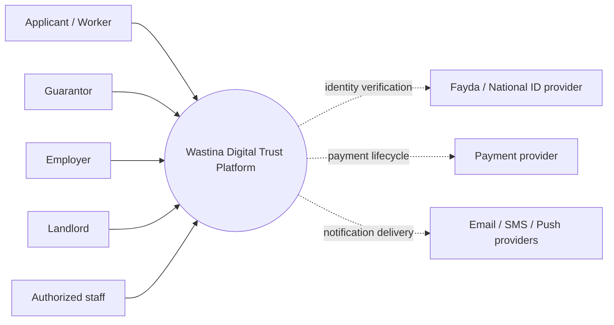
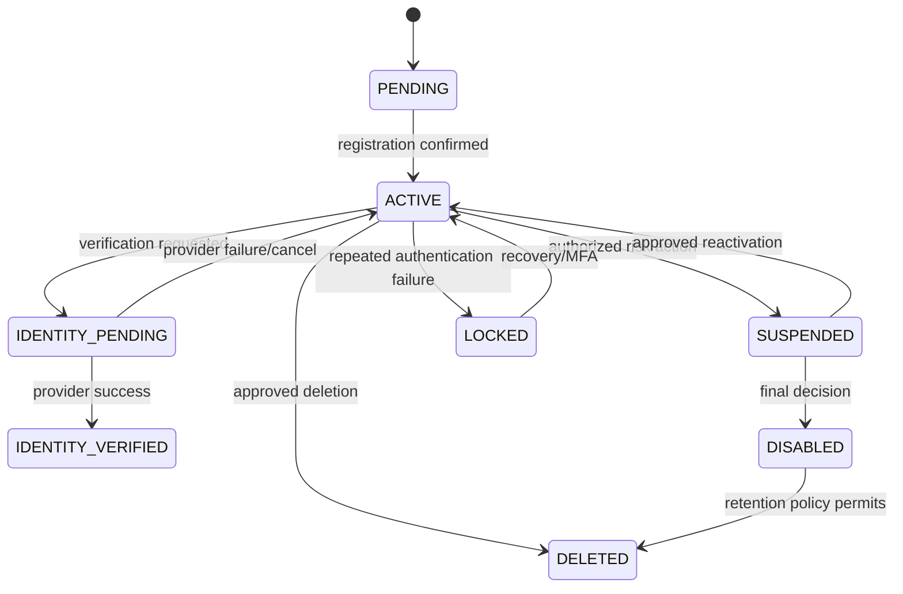
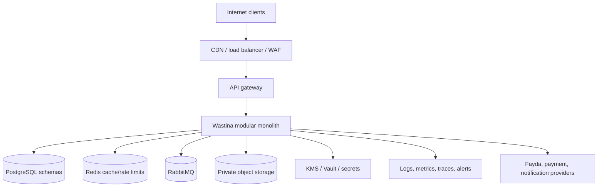

# Wastina Digital Trust Platform
## Task 1: System Architecture and Identity Standards

**Document owner:** Hakimaj (Lakim)
**Repository:** `Hakimaj/wastina_trust`
**Status:** Architecture baseline for human review
**Date:** 2026-09-30
**Scope:** Architecture, identity, security, privacy, platform standards, and implementation boundaries only

This document is an implementation specification, not a claim that the current codebase is production-ready. Task 1 does not implement the Trust Score algorithm, guarantee workflows, payment providers, dispute logic, or Fayda integration.

## 1. Architecture Executive Summary

Wastina should start as a **modular monolith with extraction-ready bounded contexts**, deployed as one Spring Boot application and one PostgreSQL database cluster with schema ownership per context. It must expose explicit module APIs, publish domain events through a transactional outbox, and prohibit cross-module table writes. This gives a small team one deployable unit and one transaction boundary while preserving service contracts for later extraction.

The first production shape is:

```text
Web and future mobile clients
            |
     CDN / load balancer
            |
 API gateway / edge policy
            |
 Wastina modular monolith
  IAM | Trust | Guarantee | Employment
  Dispute | Document | Payment | Notification
  Audit | Outbox publisher
       |          |          |
 PostgreSQL   Redis       Object storage
       |          |          |
  Key management / secrets / observability
       |
 External providers: Fayda, payment, email, SMS, push
```

The security model separates four concepts:

| Concept | Meaning | Wastina implementation |
|---|---|---|
| Authentication | Who controls the account? | OIDC authorization code flow, password/passkey policy, MFA, sessions |
| Authorization | What may the caller do? | Permission and scope checks at edge and inside the owning module |
| Identity proofing | How strongly is the account linked to a real person? | Provider-backed verification record and assurance level |
| Business verification | Is a claimed relationship true? | Employment, guarantor, landlord, or organization workflow |

Fayda is an **external verification provider**, not a Wastina database. Wastina stores the minimum provider reference and outcome required for its stated purpose. Fayda protocol details that are not published by an official source remain explicitly unverified.

## 2. System Context

### Users and external parties

- Applicants and workers create accounts and manage their own trust-related information.
- Guarantors accept and manage guarantee obligations.
- Employers verify employment relationships and submit authorized employment information.
- Landlords may request or consume narrowly scoped guarantee information.
- Compliance officers investigate complaints and disputes.
- Finance operators reconcile payments but do not receive broad identity access.
- Security administrators manage identity/security configuration but cannot decide disputes alone.
- Auditors inspect immutable audit trails.
- Fayda, payment, messaging, and storage providers are external trust boundaries.

### C4 system context



### Trust boundaries

1. Internet to edge: untrusted; TLS, WAF/rate limits, request limits, and correlation IDs are applied.
2. Edge to application: authenticated transport; forwarded security headers are stripped and recreated by the trusted proxy.
3. Application to module: authorization is re-evaluated by the owning module; gateway checks are not sufficient.
4. Application to database/object storage: private network, service identity, least privilege, encryption, and audit.
5. Application to providers: outbound allow-list, TLS, timeout, circuit breaker, signed callback verification, and provider-specific credentials.
6. Staff to sensitive data: privileged, purpose-bound access with step-up authentication and audit.

## 3. Architecture Options

| Option | Benefits | Costs/risks | Decision |
|---|---|---|---|
| Independent microservices now | Independent deploy/scale and failure isolation | Distributed transactions, multiple databases, service discovery, tracing, operational cost, larger attack surface | Reject for initial release |
| Modular monolith | One deployment and transaction boundary; simple local operation; clear modules | A bad module boundary can become a shared-code monolith; scaling is coarse | Selected initially |
| Hybrid from day one | Isolates high-risk identity/payment/document capabilities | Still needs distributed operations and contracts before the team has stable domain behavior | Future transition option |

The falsifiable basis for this choice is the current repository: one Spring Boot application, small team indicators, and business workflows that require strong consistency. Extraction triggers are: independent scaling need, separate team ownership, materially different availability requirements, or a security boundary that cannot be achieved in-process. Any extraction requires an ADR, contract tests, data migration plan, and operational runbook.

## 4. Recommended Architecture

### Client strategy

Start with one responsive web application with role-aware views. An administrative portal is a separate route and deployment boundary only when staff workflows need stronger network/device controls. A native mobile application is justified later for offline-friendly, camera/document, push, or device-bound authentication needs. It must use the same OIDC and API contracts, not a second identity store.

### Edge/API gateway

The gateway/load balancer must provide:

- TLS 1.3 preferred; TLS 1.2 only for an approved compatibility need.
- Routing to the modular monolith and later resource services.
- Authentication token pre-validation for early rejection, never as the only authorization layer.
- Endpoint, account, client, IP, and device-aware rate limiting.
- Maximum body, header, URL, upload, and timeout limits.
- Exact CORS allow-list; no wildcard credentials.
- HSTS, CSP where applicable, `X-Content-Type-Options`, clickjacking protection, and a restrictive `Referrer-Policy`.
- A server-generated `request_id` and propagated `trace_id`; client-supplied IDs are stored only as a bounded external reference.
- `/api/v1/...` versioning and deprecation headers.
- WAF/bot/credential-stuffing controls and anomaly alerts.

Every resource module must independently validate issuer, signature, expiry, audience, scopes, account state, and object ownership. Internal routes are not trusted merely because they are private.

### Module communication

- Use synchronous in-process module interfaces for commands needing immediate validation and a clear result.
- Use the outbox for durable events and asynchronous notifications, indexes, analytics, and trust propagation.
- Do not use direct repository access across modules.
- Do not use an event to replace a command where the caller needs an immediate business decision.

## 5. Service / Bounded Context Design

| Context | Owns | Strong consistency boundary | Primary events |
|---|---|---|---|
| IAM / Identity | Account, credentials reference, sessions, roles, permissions, provider verification | Account state, role grant, session revocation | `UserRegistered`, `IdentityVerificationRequested`, `IdentityVerified`, `IdentityVerificationFailed`, `RoleAssigned`, `AccountSuspended` |
| Trust | Trust profile, score versions, scoring inputs and explanations | Score version publication and input ledger | `TrustScoreCalculated`, `TrustScorePublished` |
| Guarantee | Guarantee request, agreement, liability, capacity reservation, lifecycle | Acceptance, capacity/liability limits, completion/default | `GuaranteeCreated`, `GuaranteeAccepted`, `GuaranteeCompleted`, `GuaranteeDefaulted` |
| Employment | Employment record, organization relationship, verification request, rating | Verification decision for one record | `EmploymentVerificationRequested`, `EmploymentVerified`, `EmploymentRejected` |
| Dispute / Compliance | Complaint, investigation, evidence links, decision, appeal, hold | State transition and decision authorization | `ComplaintFiled`, `DisputeUpheld`, `DisputeCleared`, `AppealFiled` |
| Document | Metadata, versions, upload state, scan result, object references, retention hold | Upload/scan/publication state | `DocumentUploaded`, `DocumentScanCompleted`, `DocumentQuarantined`, `DocumentAccessed` |
| Payment | Intent, provider reference, state machine, webhook receipt, reconciliation, refund | Idempotent financial state transitions | `PaymentInitiated`, `PaymentSucceeded`, `PaymentFailed`, `PaymentReversed` |
| Notification | Notification intent, template, preferences, delivery status | Deduplication and delivery state | `NotificationRequested`, `NotificationDelivered`, `NotificationFailed` |
| Audit | Append-only security and business audit records | Append and integrity verification | `AuditRecorded` |

Notification is a separate interface and initially a module, not a separately deployed service. Audit is centrally queryable but write-only from business modules through an audit port; ordinary application users cannot update or delete audit records.

### Ownership matrix

| Object | Owner / write authority | Read access | Important controls/events |
|---|---|---|---|
| User/account | IAM only | Other modules receive opaque user ID and approved status claims | account lifecycle; no shared writes |
| Role assignment | IAM only | Authorization policy adapter | every grant/revoke audited |
| Identity verification | IAM only | Trust receives assurance outcome; no raw ID | consent, provider reference, status |
| Trust profile/score | Trust only | User and authorized consumers via projection | versioned explanation and audit |
| Guarantee/liability | Guarantee only | Trust consumes events; parties see policy-filtered views | capacity reservation and optimistic lock |
| Employment record | Employment only | Trust consumes verified outcome; subject controls disclosure | employer relationship authorization |
| Complaint/decision | Dispute only | parties receive permitted case view; Audit receives record | separation of investigator and decider |
| Document metadata | Document only | owning business module by reference | malware scan, signed download URL |
| Payment intent/state | Payment only | Guarantee/operations receive status events | provider reference and idempotency |
| Notification | Notification only | originating module receives delivery result | provider abstraction |
| Audit record | Audit only | security/audit roles, with field masking | append-only, integrity checks |

## 6. Authentication and Identity Architecture

### Identity layers

```text
Person
  -> client (browser/mobile/admin)
  -> OIDC authorization server (Keycloak initially)
  -> Wastina resource/API modules
  -> IdentityVerificationProvider adapter
  -> Fayda or approved alternative provider
```

Authentication establishes an account session. Identity proofing is a separate, consented workflow with a provider and assurance result. Employment verification is a separate business workflow and must never be inferred from identity proofing.

### OIDC/OAuth design

- Use a mature authorization server, preferably Keycloak for the initial self-hosted/local-compatible baseline; do not build an authorization server in Wastina.
- Browser and mobile clients use Authorization Code with PKCE (`S256`), exact registered redirect URIs, `state`, and OIDC `nonce`.
- Do not use implicit grant or resource-owner-password credentials grant.
- APIs are resource servers and validate signed access tokens using issuer metadata and JWKS.
- Tokens are audience-restricted to the API/resource server and contain only `iss`, `sub`, `aud`, `exp`, `iat`, `jti`, narrowly needed scopes, and a role/permission reference where policy permits.
- Never put national ID, password, financial data, dispute evidence, or detailed business profile data in a token.
- Access token target: 5-10 minutes, subject to security review. Refresh tokens are rotated, bound to the client/session, inactive-expiring, and revoked on logout, password change, account suspension, or replay detection.
- Session termination revokes the server-side grant/refresh token family. Short-lived access tokens naturally age out; high-risk actions require current authentication or step-up MFA.
- Signing keys are asymmetric and published through JWKS. Rotation supports overlapping old/new keys and `kid` validation.
- Validate with bounded clock skew, suggested maximum 60 seconds, and reject `alg=none` or unexpected algorithms.
- Service-to-service calls use OAuth client credentials with workload identity and audience-restricted tokens. mTLS is added for high-risk inter-service paths or when platform support makes it practical.

The current repository has a custom JWT filter and local password authentication. That is an implementation gap against this baseline; it must not be expanded into a second identity platform without an ADR.

## 7. Fayda Integration Architecture

The application defines:

```java
interface IdentityVerificationProvider {
    VerificationStart start(VerificationRequest request);
    VerificationResult handleCallback(ProviderCallback callback);
    VerificationStatus getStatus(ProviderTransactionReference reference);
}
```

Implementations are `FaydaIdentityProvider`, `SandboxIdentityProvider`, and `MockIdentityProvider`. IAM owns orchestration, consent, status, retry, and provider transaction records. The adapter owns provider protocol details.

### Confirmed from official public material

- The National ID site describes Fayda as a foundational Ethiopian identity system established under Proclamation 1284/2023 and describes a 12-digit Fayda Number.
- The site describes minimal enrollment data, demographic fields, biometric enrollment, an eKYC/integrated-partner entry point, and a Fayda mobile app.
- The public enrollment material does not by itself establish the exact relying-party API, callback format, OAuth profile, returned claims, rate limits, storage restrictions, or production onboarding process.

### Unverified - requires confirmation from the official Fayda integration/onboarding channel

- Whether Wastina can use a public API or must complete partner onboarding.
- Exact authentication, authorization, sandbox, endpoint, callback, redirect, and webhook requirements.
- Whether a relying party receives a Fayda Number, opaque subject, signed assertion, token, or only a yes/no result.
- Consent text, approved purposes, permitted returned attributes, biometric exposure rules, retention/storage location, rate limits, SLAs, and contractual restrictions.
- Whether a test environment and synthetic identities are available.

### Consent and data flow

1. Explain the purpose, data categories, provider, decision impact, retention, and user rights in the selected language.
2. Capture explicit consent/authorization metadata: user ID, policy version, purpose, categories, timestamp, locale, source, and withdrawal status.
3. Start provider verification with a one-time transaction reference. Do not place sensitive values in URLs.
4. Validate the callback using provider-documented signature, nonce/state, transaction binding, expiry, replay detection, and allow-listed origin.
5. Store only provider name, opaque provider subject/reference, verification result, assurance level, timestamps, consent reference, and error category.
6. Do not store raw Fayda number, raw biometrics, identity images, or provider tokens unless official/legal review proves necessity. Never log them or place them in JWTs.

If raw national-ID data becomes necessary, use field-level envelope encryption with AES-256-GCM or an approved equivalent, KMS-managed key encryption keys, separate access policy, masking, redaction, access audit, retention hold, and deletion workflow. This is not a default.

## 8. Authorization Architecture

Use **RBAC plus resource/relationship checks**, with ABAC for sensitive policy conditions. A role is a coarse assignment; it is never proof of ownership.

| Role | Example permissions | Scope constraints |
|---|---|---|
| APPLICANT | `profile:view:self`, `guarantee:create`, `document:upload:self` | own account and permitted counterparties |
| GUARANTOR | `guarantee:view:self`, `guarantee:accept`, `liability:view:self` | own guarantees and disclosed counterparties |
| EMPLOYER | `employment:verify`, `employment:view:managed` | organization relationship and assigned records |
| LANDLORD | `guarantee:request`, `guarantee:view:consented` | transaction and consent scope only |
| SUPPORT_AGENT | `support:case:view` | masked data; no decisions or raw identity |
| COMPLIANCE_OFFICER | `dispute:review`, `identity:review:limited` | assigned cases; separation of duties |
| FINANCE_OPERATOR | `payment:reconcile` | payment data only, no identity evidence |
| SECURITY_ADMIN | `security:manage`, `session:revoke` | no unilateral dispute or score decisions |
| AUDITOR | `audit:view` | read-only, masked by default |
| ADMIN | platform configuration | two-person approval for privileged/high-impact actions |

Object authorization checks: subject/account match, organization membership, counterparty relationship, explicit disclosure consent, case assignment, state transition, tenant/resource scope, and current account status. Sensitive identity access requires a separate permission such as `identity:view_sensitive`, step-up authentication, purpose code, and audit.

### Multi-role account model

One `UserAccount` represents one digital account/person. `RoleAssignment` contains role, status, issuer, scope, effective dates, and audit references. Role-specific profiles are separate records keyed by user ID. The client may request an active role for a session, but IAM verifies that the assignment is active and issues only permitted scopes. Changing role context never changes the underlying user ID and cannot bypass object checks.

### Account lifecycle



Suspension/disablement revokes active sessions and prevents new guarantees, payments, role grants, and sensitive access. Existing guarantees remain immutable and move according to Guarantee policy; they are not silently cancelled. Employment records and disputes remain available only as required by policy/holds. Deletion is account deactivation plus data minimization, not destruction of records under a legal or dispute hold. Legal retention and reactivation rules are **HUMAN DECISION REQUIRED**.

## 9. Data Architecture

### PostgreSQL decision

Use PostgreSQL as the system of record. Initially use one managed PostgreSQL cluster with separate schemas and database roles per bounded context. This is cheaper and easier to operate than many databases, while preventing accidental cross-context writes through credentials and migrations. Extracted services receive independent databases later.

The existing MySQL and Neo4j dependencies are not the Task 1 target. Neo4j may be reconsidered for a proven graph-query workload, but it is not required for an auditable initial trust ledger.

### Data rules

- Use UUIDv7 for internal and public identifiers: time-ordered, non-sequential to users, and index-friendly. If the Java stack lacks a stable UUIDv7 library, use a vetted implementation behind an ID abstraction.
- Never expose database sequences or national/provider identifiers as public resource IDs.
- Store timestamps as `timestamptz` in UTC. Store date-only employment/contract dates as `date`; display in Ethiopia time where appropriate.
- Use optimistic locking (`version` integer) on mutable aggregate roots and conditional state transitions.
- Use `created_at`, `updated_at`, `created_by`, `updated_by`, and state-transition actor/reason fields. Soft deletion is only for user-facing mutable records; audit, payment ledger, and legal records are append-only or retention-held.
- Monetary ETB values use PostgreSQL `numeric(19,2)` and Java `BigDecimal` with explicit scale and rounding policy. Never use floating point.
- Use unique constraints for normalized email/phone where product policy permits, provider transaction ID, idempotency key per authenticated principal and endpoint, and one active relationship where required.
- Index foreign keys, state/status plus time, public ID, normalized lookup values, outbox readiness, and webhook provider reference. Do not index raw sensitive values unless a reviewed blind-index design is necessary.
- Apply migrations through versioned Flyway/Liquibase scripts in CI/CD. No production manual schema edits.
- Backups are encrypted, isolated from the primary account, tested by restore, and support point-in-time recovery.

### Consistency and race prevention

Strong consistency is required for account creation, role grants, guarantee acceptance, liability/capacity reservation, payment state transitions, and dispute decisions. Use one database transaction, row locks or serializable/optimistic retries, unique constraints, and state-machine guards. Two concurrent guarantee requests must reserve capacity atomically before either becomes accepted.

Eventual consistency is acceptable for notifications, search projections, analytics, and non-blocking trust score propagation. Consumers are idempotent and expose lag metrics.

### Idempotency

Commands that can create financial, liability, identity, or legal effects require `Idempotency-Key`. Store key, authenticated principal/client, endpoint, request fingerprint, status, response reference, and expiry. A repeated matching request returns the original result; a changed request is rejected as `IDEMPOTENCY_CONFLICT`. Recommended retention is a configurable policy value, not a legal retention claim; Payment and webhook retention require business/legal approval.

## 10. Encryption and Key Management

### Encryption

- External and internal traffic uses HTTPS/TLS; internal TLS is required when traffic crosses hosts or trust zones.
- Database and object storage use provider-managed encryption at rest.
- Restricted fields use application-level authenticated encryption, preferably AES-256-GCM through a vetted library. Each record has a unique random nonce/IV, ciphertext, authentication tag, key ID, and version. Never reuse a nonce with a key.
- Envelope encryption: KMS/Vault key-encryption key protects per-record/data-encryption keys. Application services receive only the minimum decrypt permission.
- JWT signing keys, encryption keys, contract-signing keys, and webhook HMAC secrets are separate key purposes and credentials.
- Secrets never appear in Git, Docker images, logs, exception messages, URLs, or test fixtures.

### Key management

Cloud-neutral interface: KMS or Vault for key operations, managed secret store for credentials, and certificate manager for TLS. AWS KMS, Azure Key Vault, GCP KMS, or HashiCorp Vault are valid deployments; the selected provider requires an ADR based on hosting choice.

Key hierarchy: root KMS/HSM-protected key -> key-encryption keys by purpose/environment -> data-encryption keys. Rotate keys according to risk and provider policy, retain old key versions for decrypting retained ciphertext, and re-encrypt on a planned schedule. Rotate provider credentials, webhook secrets, TLS certificates, and signing keys separately. Test recovery using a documented break-glass process with dual approval.

## 11. Event Architecture

Use RabbitMQ initially: durable queues, routing, retries, dead-letter exchanges, and low operational overhead fit module events and moderate throughput. Kafka is deferred until retention/replay volume, partition ordering, independent consumers, or analytics throughput justify its operational cost.

### Outbox contract

Each context writes business state and an `outbox_event` row in one transaction. A publisher claims unpublished rows, publishes a stable event envelope, records attempts, and retries with backoff. Poison messages go to a dead-letter queue and alert operations. Delivery is at-least-once; every consumer uses an inbox/deduplication key (`event_id`) and idempotent transaction. Ordering is guaranteed only per aggregate key where required.

### Event catalog

| Event | Producer | Consumers | Ordering / idempotency |
|---|---|---|---|
| `UserRegistered` | IAM | Notification, Audit | per user; dedupe event ID |
| `IdentityVerificationRequested` | IAM | Audit, Notification | per verification transaction |
| `IdentityVerified` | IAM | Trust, Notification, Audit | per user verification version |
| `IdentityVerificationFailed` | IAM | Notification, Audit | per attempt |
| `EmploymentVerified` | Employment | Trust, Notification, Audit | per employment record |
| `GuaranteeCreated` | Guarantee | Trust, Notification, Audit | per guarantee |
| `GuaranteeAccepted` | Guarantee | Trust, Payment if applicable, Notification, Audit | strict per guarantee state sequence |
| `GuaranteeCompleted` | Guarantee | Trust, Notification, Audit | strict per guarantee |
| `GuaranteeDefaulted` | Guarantee | Trust, Dispute, Notification, Audit | strict per guarantee |
| `ComplaintFiled` | Dispute | Notification, Audit | per complaint |
| `DisputeUpheld` / `DisputeCleared` | Dispute | Trust, Notification, Audit | decision version; dedupe |
| `PaymentInitiated` | Payment | Guarantee, Notification, Audit | provider intent key |
| `PaymentSucceeded` / `PaymentFailed` | Payment | Guarantee, Trust, Notification, Audit | provider reference + event ID |
| `DocumentUploaded` | Document | Dispute/Employment/Guarantee, Audit | per document version |
| `DocumentQuarantined` | Document | owning context, Notification, Audit | per document version |

Payloads contain opaque IDs, event metadata, version, occurred time, aggregate ID, and minimal business facts. They do not contain raw national ID, access tokens, passwords, biometrics, or document contents.

## 12. API Standards

Base path: `/api/v1/{resource}`. Use `GET` for safe reads, `POST` for commands/creation, `PUT` for full replacement where supported, `PATCH` for controlled partial updates, and `DELETE` only where deletion semantics are approved. Return `201` with `Location` on creation, `202` for accepted asynchronous work, `204` for successful empty updates, `400` validation, `401` unauthenticated, `403` unauthorized, `404` non-disclosing not found, `409` conflict/version/idempotency, `422` semantically invalid command, `429` rate limited, and `503` dependency unavailable.

Standard error:

```json
{
  "error": {
    "code": "RESOURCE_NOT_FOUND",
    "message": "The requested resource was not found.",
    "request_id": "01J...",
    "details": []
  }
}
```

Do not expose stack traces, SQL, class names, provider credentials, internal IDs, or whether a sensitive account exists. Validate JSON schema, lengths, enum values, content types, and business state. Pagination uses opaque cursor tokens for large/sensitive lists; default page size is bounded. Sorting/filtering is allow-listed. Use ETags/`If-Match` or an explicit version for mutation concurrency. Document all contracts in OpenAPI and test them in CI.

## 13. Security Architecture and Baseline

- Passwords: Argon2id preferred; if BCrypt remains temporarily, use a reviewed cost and migration plan. Password reset tokens are one-time, short-lived, hashed at rest, and enumeration-resistant.
- MFA: required for staff, privileged actions, recovery, and risk-triggered users; prefer passkeys/WebAuthn where supported, with carefully controlled fallback.
- API: parameterized queries/JPA parameters, output encoding, strict content types, SSRF egress allow-list, upload type/size limits, malware scan, and no unvalidated redirects.
- Browser: SameSite secure cookies if a BFF/session pattern is used; CSRF protection for cookie-authenticated state changes. A pure bearer-token native flow still needs OAuth redirect protections.
- CORS: exact origins and methods; no credentialed wildcard.
- Abuse: progressive login/OTP/reset throttling, account lock/risk challenge, device/session signals, and generic responses for account enumeration.
- SDLC: dependency scanning, SAST, DAST, secret scanning, container image scanning, signed build artifacts, SBOM, patch SLAs, and security regression tests.
- Map verification to OWASP ASVS 5.0.0 versioned identifiers, especially authentication, session, access control, validation, cryptography, logging, data protection, and configuration. Record the exact ASVS requirement ID in test evidence.

## 14. Privacy-by-Design and Data Classification

Ethiopian legal conclusions are not made here. The architecture requires counsel to confirm the applicable Ethiopian personal-data, national-ID, financial, employment, electronic-transactions, and retention rules before production onboarding.

| Class | Examples | Required handling |
|---|---|---|
| Public | Product information, published help content | integrity, normal access control |
| Internal | Operational metrics, non-sensitive configuration | authenticated staff/service access |
| Confidential | Employment history, guarantee details, private profile, payment metadata | encryption at rest, least privilege, access audit, masked exports |
| Restricted | Provider identifiers, national ID data if retained, credentials, raw evidence, financial secrets, dispute/legal evidence | field/object encryption, strict purpose access, step-up auth, detailed audit, no logs/JWTs, export controls |

### Requirement classification

| Finding | Classification |
|---|---|
| Fayda public site describes minimal enrollment data and an eKYC/integrated-partner route | Confirmed Ethiopian/public-source fact |
| Exact relying-party API, returned identity artifact, rate limits, sandbox, and storage contract | Unverified - official Fayda confirmation required |
| Data minimization, purpose limitation, access control, encryption, retention review, breach process | International engineering best practice; Ethiopian legal mapping requires counsel |
| Consent metadata, masked views, provider-reference storage, deletion holds | Engineering recommendation pending legal/business review |
| Legal basis, subject rights, exact retention, cross-border/cloud requirements, breach deadlines | HUMAN DECISION REQUIRED; obtain Ethiopian legal advice and primary sources |

Do not invent retention periods. Each data class gets a policy with owner, purpose, legal/business basis, minimum period, review date, deletion/anonymization action, hold override, and evidence. A deletion request creates a workflow; it does not erase active guarantees, payment records, audit evidence, or dispute-held records without an approved retention decision.

## 15. Audit Architecture

Audit records contain `event_id`, timestamp, actor ID/service identity, actor role, action, target type/opaque target ID, outcome, reason/purpose, source IP where approved, device/user-agent metadata where approved, request/correlation/trace IDs, policy version, and before/after references. Do not store full sensitive payloads; store a redacted summary or cryptographic hash/reference.

Audit is append-only to the application, uses a separate database role/schema, restricted retention administration, immutable/WORM export where available, integrity chaining or signed batches, and alerts on gaps or unexpected writers. Security events include login success/failure, password/MFA/session changes, role/permission changes, sensitive identity access, provider verification, guarantee states, employment decisions, dispute decisions, payments, document access, and score publication.

## 16. Threat Model

| Asset | Threat | Likelihood/impact | Mitigation and detection | Residual risk |
|---|---|---|---|---|
| Account/session | Credential stuffing, token theft | plausible/high | OIDC, MFA, PKCE, short tokens, rotation, rate limits, anomaly alerts | compromised device |
| Identity reference | Fake identity, provider callback forgery | plausible/critical | provider adapter, signed/nonce-bound callbacks, consent, no raw ID, audit | provider compromise; official contract unknown |
| Guarantee liability | Race, repudiation, malicious user | plausible/high | transactional reservation, state machine, optimistic lock, immutable events, dispute path | business rule errors |
| Employment trust signal | Fake employer or collusion | plausible/high | organization membership, assigned records, verification evidence, separation of duties | collusion and offline fraud |
| Restricted documents | Malicious upload or insider download | plausible/high | quarantine/scan, signed URLs, object authorization, watermark/masking, access audit | authorized-user misuse |
| Payment state | Replay/fake webhook/provider outage | plausible/high | idempotency, signature verification, provider reference, reconciliation, pending state | provider data error |
| Audit/score | Insider alteration | possible/critical | append-only audit, least privilege, dual approval, integrity monitoring | privileged infrastructure compromise |
| Service boundary | Compromised service lateral movement | possible/high | service identity, audience scopes, mTLS where needed, network policy, per-module authorization | host/platform compromise |
| Availability | DB, broker, Fayda, storage failure | plausible/high | timeouts, retries, circuit breakers, backups, pending/fail-safe states | regional outage |
| Privacy | overcollection, leakage via logs/tokens | plausible/critical | classification, minimization, redaction tests, DLP/log review | unknown legal obligations |

No numeric probabilities are asserted. Threat treatment is reviewed at every major feature and provider change.

## 17. Architecture Diagrams

The system-context diagram appears in Section 2. The deployment diagram below, together with the IAM and provider flow diagrams in Sections 6 and 7, provides the required C4/context and security-sensitive component views. The bounded-context ownership table in Section 5 is the container-level responsibility view.

### Deployment Architecture



Environments are local, development, staging, and production with separate credentials, keys, databases, buckets, and provider tenants. CI/CD builds a pinned container, runs tests/scans/SBOM, migrates schema through an approved job, deploys with health checks, and supports rollback. Developers cannot directly access or alter production databases. Infrastructure is declared in Terraform/OpenTofu or the selected cloud-neutral IaC tool.

Kubernetes is deferred. Docker Compose is sufficient locally and a managed container platform or VM/container service is the first production deployment. Kubernetes requires a later ADR based on replicas, autoscaling, team operations, and availability needs; it is not a default milestone.

### Availability and recovery

- Fayda unavailable: existing authenticated users can access allowed data; new verification is `PENDING`; no permission or trust benefit is granted.
- Payment unavailable: create/initialize may be rejected or remain `PENDING`; never mark success locally without verified provider evidence.
- Broker unavailable: transactions with outbox rows may continue if synchronous safety is preserved; asynchronous effects wait and alert.
- Object storage unavailable: no document is marked available; existing metadata remains, downloads fail closed.
- Database unavailable: return bounded `503`; do not guess state or retry non-idempotent commands blindly.

Initial MVP target: RPO up to 24 hours and RTO up to 8 hours, subject to capacity and provider commitments. Improve to lower RPO/RTO only after restore tests and operating budget justify it. Use daily encrypted backups plus WAL/PITR where managed PostgreSQL supports it, isolated backup credentials, and quarterly restore tests. Regional failure recovery, key recovery, and object restore require a documented runbook.

## 18. Observability

Use structured JSON logs with severity, service/module, environment, request ID, trace ID, actor class, and outcome. Redact tokens, passwords, national IDs, biometric data, document content, and payment secrets before serialization. Metrics include latency/error rate, authentication failures, token failures, authorization denials, rate-limit blocks, provider failures, payment reconciliation gaps, scan failures, DB latency, outbox age, queue depth, consumer lag, and restore-test status. Use OpenTelemetry-compatible traces across HTTP and message boundaries. Sampling must not remove security/audit events.

## 19. Local Development Architecture

Provide a Compose profile with PostgreSQL, Redis, RabbitMQ, MinIO, Keycloak, Mock Fayda, and Mock Payment. Each dependency uses synthetic data only. Include `.env.example` for non-secret configuration and a separate ignored local secret file mechanism; production secrets come only from the secret manager. Seed roles and test users through scripts, not committed real credentials.

Suggested repository shape:

```text
wastina_trust/
  src/main/java/com/wastina/trust/
    iam/
    trust/
    guarantee/
    employment/
    dispute/
    document/
    payment/
    notification/
    audit/
    shared/                 # technical primitives only, no business ownership
  src/main/resources/db/migration/
  contracts/openapi/
  contracts/events/
  docs/architecture/
  infrastructure/local/
  infrastructure/environments/
  scripts/
  src/test/
```

No module imports another module's entity or repository package. Shared code is limited to IDs, error envelopes, clock, correlation context, and event envelope.

## 20. Technology Stack Decision

| Area | Options | Selected | Reason / risk / alternative |
|---|---|---|---|
| Backend | Spring Boot, FastAPI, NestJS, Go | Spring Boot | Existing code and Java security ecosystem; risk of retaining insecure custom JWT; alternative is a future extraction service |
| Frontend | React, Next.js, Angular | React-based responsive web | broad client ecosystem and shared role UI; SSR is not required initially; Next.js remains an option |
| DB | PostgreSQL, MySQL, document DB | PostgreSQL | transactions, numeric money, JSONB, PITR ecosystem; migration from current MySQL required |
| Messaging | RabbitMQ, Kafka | RabbitMQ initially | lower ops and suitable durable module events; Kafka later for replay/scale |
| Cache | Redis, in-memory | Redis with bounded use | distributed rate limits/session metadata; never source of truth |
| Objects | S3-compatible, MinIO | S3-compatible abstraction; MinIO local | private signed access and portability; provider selected per deployment |
| Identity | Keycloak, managed IdP, custom | Keycloak-compatible OIDC boundary | mature protocol support and local reproducibility; managed IdP may replace it later |
| Deployment | Docker, Kubernetes | Docker + managed container/VM first | controlled complexity; Kubernetes deferred by ADR |
| IDs | UUIDv4, UUIDv7, sequences | UUIDv7 | ordered indexes without public enumeration; vetted library required |
| Currency | float, integer cents, numeric | `numeric(19,2)` / `BigDecimal` | ETB amounts are exact decimal; scale policy remains explicit |
| Graph | Neo4j, relational projections | PostgreSQL first | auditability and simpler operations; Neo4j only after measured query need |

## 21. Architecture Decision Records

Full ADRs are in [`docs/architecture/adrs.md`](adrs.md). The initial decisions are ADR-001 modular monolith, ADR-002 PostgreSQL schemas, ADR-003 OIDC/Keycloak boundary, ADR-004 JWT access-token policy, ADR-005 RabbitMQ/outbox, ADR-006 S3-compatible objects, ADR-007 KMS/Vault keys, ADR-008 Fayda adapter boundary, ADR-009 authenticated encryption, and ADR-010 deferred Kubernetes.

## 22. Testing Strategy

Architecture tests are required before feature implementation:

- Security integration tests reject missing, expired, wrong-issuer, wrong-audience, wrong-scope, revoked-session, and wrong-object requests.
- Multi-role tests confirm one user ID, scoped role activation, and no role-only bypass.
- Provider contract tests run against Mock Fayda and verify consent, callback binding, replay rejection, timeout, and failure behavior.
- Transaction/outbox tests prove business state and outbox row commit or rollback together; publisher retry and dead-letter behavior is tested.
- Concurrency tests submit simultaneous guarantee acceptance requests and prove capacity cannot be exceeded.
- Idempotency tests cover guarantee creation, payment intent, payment webhook, provider callback, employment verification, and complaint submission.
- Upload tests cover file limits, content-type confusion, malware quarantine, signed URL authorization, and document access audit.
- CI runs SAST, dependency/SBOM, secret, container, DAST, and ASVS-mapped regression checks.

## 23. Human Decisions Required

`HUMAN DECISION REQUIRED` before production implementation:

- Ethiopian counsel: processing basis/consent, Fayda terms, national ID handling, retention/deletion, dispute/legal records, e-signature, cloud location, cross-border processors, breach response, and financial regulation.
- Security review: OIDC deployment, privileged roles, key hierarchy/recovery, callback validation, audit integrity, production network, and provider onboarding.
- Product/business: role definitions, disclosure boundaries, guarantee limits, trust-score governance and appeal rights, dispute authority, notification consent, and support/operations ownership.
- Fayda/NIDP official channel: partner onboarding, approved eKYC flow, returned artifact, sandbox, rate limits, data storage, callback/authentication, and contractual obligations.

## 24. Task 1 Acceptance Checklist

- [x] Architecture choice and service boundaries documented.
- [x] Owning service and write authority defined for core objects.
- [x] Authentication, authorization, proofing, and business verification separated.
- [x] Fayda treated as an external dependency with unknowns marked.
- [x] No national ID in logs or JWTs; minimum-reference strategy defined.
- [x] Encryption, key separation, rotation, and recovery defined.
- [x] RBAC plus object/relationship authorization defined.
- [x] Multi-role and account lifecycle defined with state diagram.
- [x] Events, outbox, retries, deduplication, and idempotency defined.
- [x] PostgreSQL, UUID, UTC, ETB numeric, transaction, migration, backup rules defined.
- [x] API, observability, audit, privacy, threat, deployment, DR, and failure behavior defined.
- [x] Local development and architecture tests defined.
- [ ] Legal/security/product/Fayda human approvals completed.
- [ ] Provider contracts and official Ethiopian legal source mapping attached.

## 25. Research References

Primary standards and official sources consulted on 2026-09-30:

1. IETF, [RFC 9700: OAuth 2.0 Security Best Current Practice](https://www.rfc-editor.org/rfc/rfc9700).
2. OpenID Foundation, [OpenID Connect Core 1.0 incorporating errata set 2](https://openid.net/specs/openid-connect-core-1_0.html).
3. NIST, [SP 800-63-4 Digital Identity Guidelines](https://pages.nist.gov/800-63-4/) and volumes 63A/B/C-4.
4. OWASP, [Application Security Verification Standard 5.0.0](https://owasp.org/www-project-application-security-verification-standard/) and [ASVS repository](https://github.com/OWASP/ASVS/tree/v5.0.0).
5. National ID Program Ethiopia, [Fayda official public site](https://id.gov.et/), including public enrollment, minimal-data, principles, services, eKYC/integrated-partner, and website policy/terms entry points. Public material confirms high-level identity facts but does not confirm the partner protocol.
6. Ethiopian legal/regulatory source availability: official legal and data-protection pages were not sufficiently extractable during this research pass. No legal conclusion is asserted. Obtain the current primary text and counsel review before freezing retention, subject rights, transfer, or breach obligations.

International sources establish engineering guidance; they do not substitute for Ethiopian law. Foreign privacy laws are not used here as Ethiopian requirements.

## 26. ARCHITECTURE FREEZE

Later tasks must treat these as established foundations unless a documented ADR changes them:

1. Start with a modular monolith and extraction-ready bounded contexts.
2. IAM owns accounts, roles, sessions, and identity verification orchestration.
3. Authentication uses a mature OIDC authorization server; APIs validate audience-restricted tokens themselves.
4. Fayda is accessed only through `IdentityVerificationProvider`; no invented API and no default raw-ID storage.
5. Authorization combines RBAC with resource/relationship checks and sensitive-purpose controls.
6. PostgreSQL is the system of record; context schemas own their writes.
7. IDs use UUIDv7 behind an abstraction; ETB uses exact decimal `numeric(19,2)`/`BigDecimal`.
8. Durable asynchronous effects use RabbitMQ plus transactional outbox and idempotent consumers.
9. Restricted data is encrypted and never placed in logs, URLs, or JWT claims.
10. Audit is append-only, centrally protected, and covers security and business state changes.
11. Local development uses Compose-compatible PostgreSQL, Redis, RabbitMQ, MinIO, Keycloak, and provider mocks.
12. Kubernetes, Neo4j, native mobile, and independent microservices are deferred until evidence and an ADR justify them.
