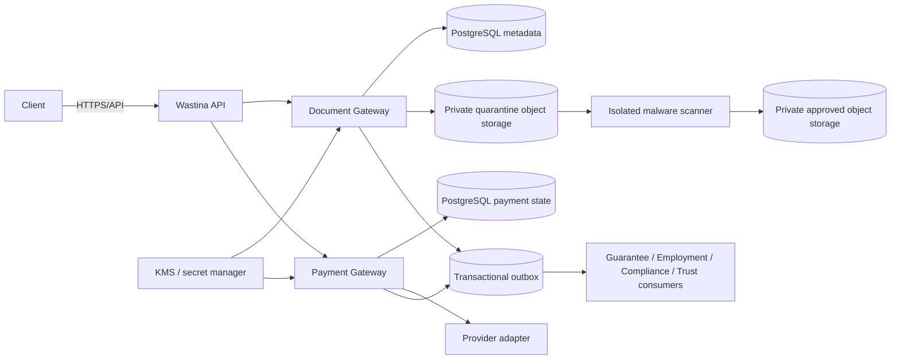

# Task 7 — Financial Gateway & Document Gateway

**Status:** Gateway foundation implemented; production provider/storage onboarding and security hardening remain required
**Date:** 2026-09-30

## 1. Repository audit and boundaries

Existing Task 4 code provided `PaymentIntent`, `PaymentProvider`, `MockPaymentProvider`, payment persistence, and a webhook skeleton. The old webhook path was only a mock compatibility seam and used a fixed mock secret plus a request-map serialization; it did not persist webhook identity or normalized provider transactions.

Task 1 already froze separate Payment and Document bounded contexts, private S3-compatible storage, quarantine/scanning, signed short-lived access, and outbox-based events. Task 5 and Task 6 already reference documents by metadata rather than owning binaries.

This task adds gateway foundations without duplicating IAM, Guarantee, Employment, Compliance, Trust, or contract-integrity ownership.

## 2. Financial Gateway

Payment owns:

- payment intents
- normalized provider transactions
- provider status and references
- webhook receipt identity and signature result
- server-side verification
- refund/reversal records
- reconciliation records
- payment events and audit metadata

Guarantee still decides how a verified payment changes guarantee state. Payment does not activate a guarantee directly.

### Payment state separation

`PaymentIntent` is the expected internal business operation. `PaymentTransaction` is the provider-side attempt/transaction. One intent may have retries or reconciliation states.

Normalized transaction states include:

`CREATED`, `PROCESSING`, `SUCCESSFUL`, `FAILED`, `UNKNOWN`, `RECONCILIATION_REQUIRED`, `REVERSED`, `REFUND_PENDING`, `REFUNDED`.

Unknown provider timeouts remain unknown until status is established. Amount or currency mismatch enters `RECONCILIATION_REQUIRED` and cannot be marked successful.

### Idempotency

Payment intent creation requires an idempotency key and returns the existing intent for the same materially identical request. Reuse with a different amount or currency is rejected. Provider transaction identity is scoped by `(provider, provider_transaction_id)`.

### Webhooks

`PaymentWebhook` persists provider, provider event ID, transaction reference, SHA-256 payload digest, signature result, processing state, and timestamps. `(provider, provider_event_id)` is unique, so duplicate callbacks are recorded as duplicates rather than producing another business effect.

Webhook authenticity is provider-specific. The gateway delegates verification to the selected provider adapter. A webhook is not itself sufficient for financial success: the transaction must be verified server-to-server and compared to expected amount, currency, merchant/reference, and current internal state.

### Refunds and reconciliation

`PaymentRefund` is separate from the payment transaction and requires a positive amount, idempotency key, reason, and authorized actor. The domain guard prevents refunding beyond the remaining paid amount.

`PaymentReconciliation` records expected/provider amounts and currencies, discrepancy type/context, status, and resolution actor. High-impact mismatches require authorized review. No provider failover or automatic business activation is implemented.

## 3. Provider status matrix

| Capability | Chapa | Telebirr | CBE Birr |
|---|---|---|---|
| Public developer documentation | Confirmed: Chapa developer documentation publishes accept payment, verify payment, webhooks, refunds, testing, and transfer sections | Official production contract not verified in this repository | Official production contract not verified in this repository |
| Adapter status | Gateway interface + mock only; official adapter contract still required | Interface boundary only | Interface boundary only |
| Webhook mechanism | Provider documentation must be followed exactly, including signature/authentication details | Provider confirmation required | Provider confirmation required |
| Refund/reversal semantics | Documentation exists, but merchant/account onboarding and exact contract require confirmation | Provider confirmation required | Provider confirmation required |
| Sandbox/production access | Test documentation exists; merchant credentials/onboarding required | Provider confirmation required | Provider confirmation required |

Status labels:

- `MockPaymentProviderGateway`: implemented for local/default testing.
- Chapa: `OFFICIAL DOCUMENTATION AVAILABLE; PRODUCTION ONBOARDING/CREDENTIALS REQUIRED`.
- Telebirr: `OFFICIAL PROVIDER API/CONTRACT REQUIRED`.
- CBE Birr: `OFFICIAL PROVIDER API/CONTRACT REQUIRED`.

No Telebirr or CBE Birr endpoints, signatures, fields, or credentials were invented.

## 4. Document Gateway

Document owns metadata, upload sessions, object references, scanning state, content hash metadata, secure retrieval authorization, retention metadata, and document lifecycle. It does not determine whether a contract is legally valid, whether employment is genuine, or whether evidence proves an allegation.

### Metadata/binary split

`Document` stores relational metadata:

- owner
- controlled type and purpose
- classification
- lifecycle and scan state
- storage provider/bucket/object key/version
- detected and declared MIME types
- byte size
- SHA-256 hash metadata
- retention/deletion timestamps

Binary content is delegated through `ObjectStorageProvider`; no production local-disk fallback exists in this gateway.

### Upload lifecycle

`DocumentUploadSession` controls an authorized, time-limited upload destination. The gateway generates opaque keys under quarantine storage:

`objects/quarantine/{year}/{random-id}`

The original filename is not used as an object key. A completion operation writes to quarantine, marks the document as pending scan, invokes `MalwareScanner`, and only permits `AVAILABLE` after a clean result and SHA-256 calculation. Scanner failure or malicious content does not become available.

Initial supported MIME policy is intended to remain narrow: PDF, JPEG, and PNG. Full magic-byte/content-type validation belongs in the production scanner/storage adapter; the mock scanner is only a test adapter.

### Download authorization

A download URL is issued only when:

- the requester is authorized for the document/business context
- the document is available or verified
- the URL is short-lived
- the storage provider returns a scoped URL

The current foundation uses a five-minute mock download URL. Production presigned URLs must use private storage, least privilege, TLS, short expiry, and audit logging. A presigned URL is bearer access and is not equivalent to session-bound authorization.

## 5. Storage recommendation

| Criterion | AWS S3 | MinIO/AIStor | Recommendation |
|---|---|---|---|
| Local development | heavier than needed | simple S3-compatible local option | MinIO/compatible mock for local only |
| Staging | managed durability and IAM/KMS | operational burden and product/license review | AWS S3 sandbox or approved managed S3-compatible service |
| Production | mature availability, IAM, versioning, KMS, lifecycle, backup ecosystem | possible with a dedicated operations/security team, KMS, TLS, replication, and license review | Managed S3-compatible object storage, preferably AWS S3 if data-location/legal review approves |
| Data location | region/provider dependent | self-controlled but still host/operator dependent | Legal/data-protection review required |
| Encryption | SSE-S3 default; SSE-KMS for customer-managed control | SSE-KMS/external KMS architecture required | KMS-backed encryption in either option |
| Presigned access | documented temporary bearer access | S3-compatible behavior must be tested | short-lived, scoped URLs only |

This is an engineering recommendation, not a legal/data-residency conclusion. MinIO/AIStor production licensing, KMS, replication, and operations require explicit confirmation.

## 6. Encryption, secrets, and scanning

- Use private quarantine/approved/archive storage separation.
- Use provider-managed or KMS-backed encryption at rest; no unencrypted fallback.
- Keep object-storage, JWT, contract-signing, and webhook secrets separate.
- Store secret references, not provider secret values, in application data.
- Run production malware scanning in an isolated, resource-limited worker.
- Do not treat a clean malware result as proof of legal validity or truth.
- Use generated object keys and no sensitive identifiers in paths.

The mock scanner recognizes a synthetic test marker only; it is not an antivirus product.

## 7. Event catalog

Payment events:

- `PaymentIntentCreated`
- `PaymentProcessingStarted`
- `PaymentSucceeded`
- `PaymentFailed`
- `PaymentExpired`
- `PaymentReversed`
- `RefundRequested`
- `RefundSucceeded`
- `RefundFailed`
- `PaymentReconciliationRequired`
- `PaymentReconciled`

Document events:

- `DocumentUploadInitiated`
- `DocumentUploaded`
- `DocumentScanStarted`
- `DocumentScanPassed`
- `DocumentScanFailed`
- `DocumentAvailable`
- `DocumentRejected`
- `DocumentVersionCreated`
- `DocumentSuperseded`
- `DocumentDeletionRequested`
- `DocumentDeleted`
- `DocumentRetentionHoldApplied`
- `DocumentRetentionHoldReleased`

Events must contain safe IDs/version/timestamps and no file contents, payment credentials, card data, PINs, OTPs, national IDs, or permanent URLs. Transactional outbox publication remains a required production follow-up.

## 8. API foundation

- `POST /api/v1/documents/upload-sessions`
- `POST /api/v1/documents/upload-sessions/{sessionId}/complete`
- `GET /api/v1/documents/{documentId}/download-url`
- `POST /api/v1/payments/intents`
- `POST /api/v1/payments/intents/{intentId}/initialize`
- `POST /api/v1/payments/transactions/{transactionId}/verify`
- `POST /api/v1/webhooks/payment`

The current controllers are foundation-only. Before production, actor identity must come from the authenticated principal rather than request-body/query IDs, relationship authorization must be enforced, and controlled error responses, rate limits, audit ports, idempotency headers, and provider-specific webhook adapters must be completed.

## 9. Data-flow diagrams

Trust boundaries: Internet/client, API/authentication boundary, gateway domain boundary, object-storage boundary, external provider boundary, and KMS/secrets boundary. No business module receives unrestricted storage/provider credentials.

## 10. Security questions answered

1. Another user cannot download a document without relationship authorization; the gateway checks requester/owner/status before URL issuance.
2. Document IDs are UUIDs, but unpredictability is not authorization; access checks remain mandatory.
3. Presigned URLs are short-lived and scoped; leaked bearer URLs remain a residual risk until expiry.
4. Unscanned documents cannot become available or receive a download URL.
5. Uploaded bytes are kept out of the application webroot and passed through a scanner; production parser isolation remains required.
6. Clients never supply the storage object key; the server generates it.
7. No business service receives unrestricted storage credentials; deletion must be owned by Document policy.
8. Fake callbacks are rejected by provider adapter signature verification; real provider-specific adapters remain required.
9. Duplicate webhooks are bounded by provider/event uniqueness.
10. Payment amount/currency are server-side intent values and transaction verification compares provider values.
11. No client payment-status field is accepted by the gateway commands; privileged manual overrides remain a production governance gap.
12. Refund validation rejects amounts over the remaining paid amount.
13. Provider ambiguity is represented as `UNKNOWN`; blind retries are not performed by this foundation.
14. The gateway does not log secrets or credentials; structured redaction remains an operational requirement.
15. Storage/KMS failure must fail closed; there is no unencrypted fallback.
16. Storage outage leaves relational metadata intact and retryable.
17. Object/metadata reconciliation and restore testing remain required before production.
18. Retention/legal-hold workflows are represented as architecture requirements but not yet fully implemented.
19. Payment state is server-owned and state-guarded.
20. Document status is server-owned and lifecycle-guarded.

## 11. Functional requirements

- `GATE-FR-001`: document metadata is stored relationally and binaries use object storage in production.
- `GATE-FR-002`: upload sessions are authorized, bounded, expiring, and use generated object keys.
- `GATE-FR-003`: files remain quarantined until scanning and content validation pass.
- `GATE-FR-004`: document hashes and versions are recorded where required.
- `GATE-FR-005`: download URL issuance checks authorization and lifecycle state.
- `GATE-FR-006`: payment intents require server-side amount, currency, provider, and idempotency values.
- `GATE-FR-007`: payment transactions are distinct from intents.
- `GATE-FR-008`: provider callbacks are persisted, signature-checked, and deduplicated.
- `GATE-FR-009`: successful payment requires server-side provider verification and amount/currency/reference matching.
- `GATE-FR-010`: reconciliation records mismatches instead of silently fulfilling business state.
- `GATE-FR-011`: refunds are separately authorized, idempotent, and bounded by refundable amount.
- `GATE-FR-012`: gateway state changes emit safe canonical events after commit through the outbox.

## 12. Non-functional requirements

- `GATE-NFR-SEC-001`: restricted objects remain private and are accessible only through authorized, short-lived access grants.
- `GATE-NFR-SEC-002`: provider secrets, card data, PINs, OTPs, and raw document contents never appear in ordinary logs/events.
- `GATE-NFR-PERF-001`: upload-session and payment-initiation latency are measured separately from scanner/provider completion time.
- `GATE-NFR-DUR-001`: database metadata and object backups are independently restorable and hash-checkable.
- `GATE-NFR-REC-001`: provider/storage outages produce retryable states without false success or unencrypted fallback.
- `GATE-NFR-AUD-001`: upload, scan, access URL issuance, webhook, verification, refund, and reconciliation operations are auditable.
- `GATE-NFR-PRIV-001`: document type, purpose, classification, and related business references are authorization-filtered.
- `GATE-NFR-MAINT-001`: provider/storage-specific behavior remains behind gateway interfaces and shared contract tests.

## 13. Test strategy and current results

Implemented focused tests cover:

- payment amount mismatch -> reconciliation required
- refund overrun prevention
- quarantine-before-availability
- synthetic malicious scan rejection
- expired upload session rejection
- generated object key not based on user filename

Full clean Maven verification is required after the migration and gateway controllers are compiled. Production follow-up tests must cover real magic bytes, spoofed MIME, size limits, authorization/BOLA, expired URLs, missing objects, hash mismatch, webhook replay, wrong reference, timeout/late success, refund races, provider outage, storage outage, KMS outage, and restore/reconciliation.

## 14. Retention and backup policy status

Retention durations are intentionally `TBD` and require legal/business approval. Separate policy categories are required for identity documents, guarantee contracts, employment evidence, dispute evidence, receipts, payment webhooks, refunds, provider diagnostics, and audit records. Legal holds must prevent deletion while active.

Production backup design requires PostgreSQL PITR, object versioning/replication or immutable backup, separate backup credentials, KMS key recovery, metadata/object reconciliation, and restore drills. These are not claimed complete by this code slice.

## 15. Human/regulatory review

`HUMAN / LEGAL / REGULATORY REVIEW REQUIRED` for:

- National Payment System applicability and licensing boundaries
- merchant onboarding, settlement, custody, transfer/payout, refunds, and complaints
- AML/KYC and financial-record retention
- provider contracts, sandbox, production credentials, fees, and webhook obligations
- cross-border storage, processors, data location, and Ethiopian data protection
- identity/contract/evidence retention, legal holds, deletion, and sharing
- PCI scope and any card/payment credential handling

## 16. Runbook outline

- Provider outage: keep intent/transaction pending or unknown, stop blind retries, query provider, reconcile, alert.
- Webhook failure: preserve received event, retry signature-valid processing, deduplicate by provider event ID.
- Amount mismatch: set reconciliation required, do not activate Guarantee, route to authorized finance review.
- Storage outage: retain metadata/upload pending, retry storage operation, do not fall back to local/public storage.
- Scanner outage: keep quarantine/scan pending, retry scanner, do not publish document.
- Malicious upload: reject/quarantine, preserve security audit metadata, notify safely, do not expose bytes.
- KMS outage: fail closed, do not write unencrypted data, recover key service before retry.
- Lost object/hash mismatch: quarantine reference, compare backup/version, restore and verify hash, open incident.
- Leaked URL/credential: revoke or rotate where possible, inspect access logs, preserve incident evidence, reassess affected data.
- Legal hold/deletion: block lifecycle deletion, record hold/release actor, apply approved retention workflow.

## 17. Known limitations

- Real S3/MinIO adapters, KMS, ClamAV/managed scanning, outbox publisher, audit port, and reconciliation workers are not yet wired.
- Chapa is not represented as a production adapter; official documentation is available, but merchant credentials and exact contract verification remain required.
- Telebirr and CBE Birr adapters are intentionally not invented.
- Controller actor identity still uses request inputs in this foundation and must be replaced with authenticated principal context.
- Full magic-byte validation, document version replacement, retention holds, restore testing, refunds service commands, and provider-specific webhook parsing remain follow-up work.
