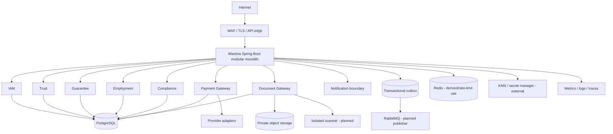

# Task 8 — Final Integration and Production Readiness

**Date:** 2026-09-30
**Current verdict:** NOT READY for production; READY WITH CONDITIONS for continued local development

## 1. Final architecture decision

The repository remains a Spring Boot modular monolith. Tasks 1-7 are bounded contexts inside one deployable application and one PostgreSQL migration stream. Kubernetes is not introduced because Task 1 explicitly deferred it; local Docker Compose and a future managed container/VM deployment remain the selected path.

## 2. Ownership and source of truth

| Domain | Owner | Current implementation | Status |
|---|---|---|---|
| Identity/authentication/roles | IAM | `User`, roles, resource-server configuration | PARTIALLY IMPLEMENTED; principal-derived authorization hardening required |
| Trust score/history/policy | Trust | deterministic calculator, event ledger, snapshots/history | TESTED foundation; event ingestion/outbox integration incomplete |
| Guarantees/contracts/liability | Guarantee | entities, capacity, contract integrity | TESTED foundation; cross-gateway integration incomplete |
| Employment | Employment | organization, membership, records, verification | TESTED foundation; event/document integration incomplete |
| Compliance | Compliance | complaint, case, evidence reference, decision, appeal, action | TESTED foundation; authorization/outbox/evidence integration incomplete |
| Payment | Payment | intent, transaction, webhook, refund/reconciliation models, mock gateway | TESTED foundation; provider onboarding and workers incomplete |
| Documents | Document | metadata, upload session, storage/scanner ports, mock adapters | TESTED foundation; production object storage/scanner/KMS incomplete |
| Events | Platform infrastructure | outbox persistence added in Task 8 | PARTIALLY IMPLEMENTED; broker publisher/inbox/DLQ incomplete |
| Audit | Audit boundary | documented but no central implementation | NOT IMPLEMENTED |

## 3. Database and transaction strategy

PostgreSQL remains the system of record for the modular monolith. Flyway migrations are authoritative and now include `V1` through `V5`, with `V5__transactional_outbox.sql` adding event durability. Cross-context workflows use local transactions plus outbox events; distributed database transactions are not used.

A future extraction must assign separate schema/database roles and preserve service ownership. Until then, repository access remains package/application controlled by convention and requires contract tests before extraction.

## 4. Event architecture

The standard event envelope is represented by `OutboxEvent` with event ID, type/version, source service, aggregate key, subject, trace/correlation IDs, payload, attempts, next retry, and publication state.

Current lifecycle:

`PENDING -> FAILED -> PENDING retry -> PUBLISHED`

After the configured retry limit:

`FAILED -> DEAD_LETTERED`

The persistence and retry state rules are tested. RabbitMQ publication, consumer inbox deduplication, broker DLQ, schema registry, and per-aggregate ordering are still required. No event is considered production-delivered merely because an outbox row exists.

## 5. Environment and deployment baseline

- Local: `docker-compose.yml` provides PostgreSQL, RabbitMQ, Redis, and MinIO with synthetic credentials only.
- CI: `.github/workflows/ci.yml` runs Maven tests, packaging, container build, dependency review on pull requests, and CycloneDX SBOM generation.
- Runtime image: `Dockerfile` uses a multi-stage Java 17 build and non-root runtime user.
- Staging: managed PostgreSQL/object storage/secrets/provider sandbox and a real scanner are required; not yet provisioned.
- Production: managed PostgreSQL with PITR/HA, private object storage, KMS/secret manager, provider contracts, RabbitMQ durability, monitoring, and approved deployment environment are required; not yet provisioned.
- Kubernetes: deferred by ADR-010; no Kubernetes manifests are introduced.

Production and non-production must use separate database, bucket, key, provider credential, broker, and OIDC namespaces.

## 6. Observability baseline

Actuator health, liveness/readiness, metrics, and Prometheus exposure are configured. Health endpoints `/actuator/health`, `/actuator/health/**`, and `/actuator/info` are public-safe; detailed health remains authorization-controlled.

Required operational telemetry still to wire:

- request latency/error rate and authorization failures
- outbox age, attempt count, dead-letter count
- payment provider latency, webhook rejection, reconciliation backlog
- document scan latency/failure, storage errors, hash mismatch
- Trust event lag/recalculation failures
- database pool/lock/slow-query metrics
- trace/correlation propagation across workers and broker

Do not place user narratives, document content, tokens, payment credentials, or national IDs in logs, metrics, traces, or events.

## 7. Security and privacy status

Implemented/tested foundations include explicit domain state machines, optimistic versions in high-risk models, payment amount/currency checks, webhook event uniqueness, document quarantine state, opaque object keys, short-lived download URL interface, and non-root container execution.

Not yet evidenced:

- authenticated-principal enforcement across all new controllers
- BOLA/IDOR integration tests
- real MIME/magic-byte validation
- production malware scanner isolation
- KMS and secret rotation
- centralized audit/immutable audit storage
- SAST, DAST, secret scan, container CVE scan execution
- penetration testing

The project must not claim ASVS compliance, payment regulatory compliance, privacy compliance, PCI compliance, or production security certification without the corresponding evidence and human review.

## 8. Failure and recovery model

- Database failure: fail closed; recover from encrypted backup/PITR; run Flyway and consistency checks.
- Broker failure: committed domain state and outbox remain; publish retries; alert on age/dead letters.
- Provider timeout: preserve `UNKNOWN`/pending; query provider and reconcile; do not blindly charge twice.
- Object storage failure: preserve metadata and pending state; retry/reconcile; never fall back to public/local storage.
- Scanner failure: retain quarantine state; do not expose file.
- KMS/secrets failure: fail closed; no unencrypted fallback.
- Deployment failure: use previous immutable image/config and forward-compatible migration strategy.

Actual RPO/RTO values are not set because workload, infrastructure, and business criticality have not been approved. A staging DR drill is still required.

## 9. Integration matrix

| Flow | Producer | Consumer | Current status |
|---|---|---|---|
| Employment verified -> Trust | Employment | Trust | Domain event contract documented; publisher/consumer incomplete |
| Payment succeeded -> Guarantee | Payment | Guarantee | Ownership documented; business transition integration incomplete |
| Document available -> Employment/Compliance | Document | owning domain | Reference model documented; real storage/scanner incomplete |
| Case upheld/overturned -> Trust | Compliance | Trust | Event model documented; outbox/consumer incomplete |
| Identity verified -> Trust | IAM | Trust | Existing Trust event model; authenticated producer pipeline incomplete |
| Notification requested | Domain services | Notification | Boundary documented; notification module absent |

## 10. Production readiness matrix

| Area | Status | Evidence/gap |
|---|---|---|
| Architecture ownership | READY WITH CONDITIONS | Tasks 1-7 docs and ADRs; extraction/security contracts pending |
| Domain state machines | READY WITH CONDITIONS | Focused unit tests; integration flows incomplete |
| Database migrations | READY WITH CONDITIONS | V1-V5 present; empty/realistic DB migration test pending |
| Authentication | NOT READY | Resource server exists; all actor IDs are not yet principal-derived |
| Authorization/BOLA | NOT READY | Domain guards exist; full endpoint integration tests absent |
| Payments | NOT READY | Mock gateway only; provider contracts/onboarding absent |
| Documents | NOT READY | Mock storage/scanner only; KMS/backup/restore absent |
| Events/outbox | READY WITH CONDITIONS | Outbox persistence/tests present; broker publisher/inbox/DLQ absent |
| Observability | READY WITH CONDITIONS | Actuator baseline present; dashboards/tracing/alerts absent |
| CI | READY WITH CONDITIONS | Workflow committed; execution in repository CI not yet observed |
| Container | READY WITH CONDITIONS | Non-root Dockerfile; image scan/signing/provenance not complete |
| DR/backups | NOT READY | No executed restore or DR drill |
| Legal/regulatory | BLOCKED BY LEGAL DECISION | Payment, privacy, retention, data location, signatures, provider contracts |

## 11. Required next gates

1. Replace request-supplied actor IDs/roles with authenticated principal context.
2. Wire transactional outbox publisher, RabbitMQ queues, retries, DLQ, and consumer inbox deduplication.
3. Add integration tests with disposable PostgreSQL/RabbitMQ/object storage/scanner adapters.
4. Complete real provider/storage/scanner/KMS onboarding and contract tests.
5. Add central audit implementation and trace propagation.
6. Execute security scans, BOLA tests, migration tests, load tests, restore tests, and a staging DR drill.
7. Obtain legal/business approval for payment, privacy, retention, cross-border storage, and score-impact policies.

## 12. Task 8 verdict

The repository is reproducible for local development and has a stronger operational baseline, but it is not a production-ready platform. The honest status is **READY WITH CONDITIONS for engineering continuation** and **NOT READY for production launch**.
